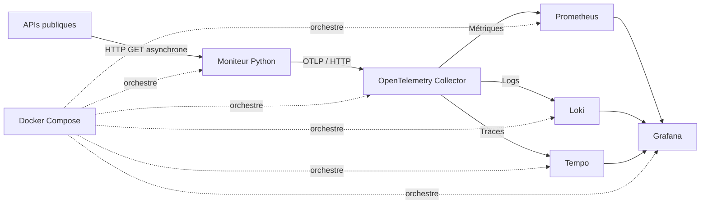

# Serverless API Observability

[](https://github.com/EthanLeChevallier/Serverless-api-observability/actions/workflows/ci.yml)

**Surveillance asynchrone d’APIs publiques, instrumentée avec OpenTelemetry et visualisée dans une stack d’observabilité exécutable en local.**

Le projet interroge des endpoints HTTP, mesure leur disponibilité et leur latence, puis corrèle métriques, logs et traces dans un dashboard Grafana. La stack est lancée avec Docker Compose ; aucune configuration de service externe n’est nécessaire.

## Ce que démontre le projet

- Contrôles HTTP concurrents avec Python 3.11+, `asyncio` et `httpx`.
- Instrumentation manuelle avec le SDK OpenTelemetry et export OTLP/HTTP.
- Collecte et routage des trois signaux vers Prometheus, Loki et Tempo.
- Dashboard Grafana et trois règles d’alerte provisionnés automatiquement.
- Tests unitaires, lint Ruff et intégration continue GitHub Actions.
- Configuration locale reproductible, sans secrets nécessaires ni déploiement distant.

## Architecture



Le processus `api-monitor` exécute un cycle immédiatement au démarrage, puis recommence à intervalle configurable. Les appels vers les cibles sont concurrents, avec une limite de concurrence et un timeout configurables. Le Collector reçoit OTLP sur le réseau privé Compose et exporte chaque signal vers son backend local.

## Démarrage rapide

### Prérequis

- Docker Desktop démarré ;
- Docker Compose v2 (`docker compose`) ;
- accès Internet pour télécharger les images au premier lancement et joindre les APIs suivies.

### Lancer la stack

Depuis la racine du dépôt :

```bash
cp .env.example .env
```

Remplace `GRAFANA_ADMIN_PASSWORD` dans `.env` par un mot de passe local. Le fichier `.env` est ignoré par Git.

```bash
docker compose up --build -d
docker compose ps
```

Ouvre [http://localhost:3000](http://localhost:3000) et connecte-toi avec `GRAFANA_ADMIN_USER` et `GRAFANA_ADMIN_PASSWORD` définis dans `.env`. Grafana charge automatiquement les sources de données, le dashboard et l’alerte.

Pour suivre les cycles de contrôle :

```bash
docker compose logs -f api-monitor
```

Les premiers panneaux Prometheus peuvent rester incomplets jusqu’à ce que plusieurs contrôles aient été effectués. Les percentiles et taux reposent sur des fenêtres temporelles ; laisse la stack collecter des points avant de les interpréter.

### Arrêter la stack

Arrêter les conteneurs tout en conservant les volumes :

```bash
docker compose down
```

Supprimer aussi les données locales stockées par les composants :

```bash
docker compose down -v
```

La seconde commande supprime les données locales de Grafana, Prometheus, Loki et Tempo.

## Dashboard

Le dashboard **Serverless API Observability (Local)** est provisionné depuis `observability/grafana/dashboards/serverless-api-observability.json`. Il présente :

| Vue | Ce qu’elle indique |
|---|---|
| Quantiles de latence p50, p95 et p99 | Distribution des durées de réponse par cible, en secondes |
| Débit des contrôles | Nombre de contrôles réussis ou échoués dans le temps |
| État courant | Dernier résultat de chaque cible : `UP` ou `DOWN` |
| Fraîcheur du contrôle | Temps écoulé depuis la dernière vérification |
| Disponibilité sur 15 minutes | Part des contrôles réussis sur la fenêtre récente |
| Codes HTTP | Répartition des statuts observés |
| Latence moyenne | Durée moyenne par cible sur 15 minutes |
| Logs et traces | Événements structurés et spans liés au contrôle des APIs |

Trois règles Grafana surveillent le p95 au-dessus de **500 ms pendant cinq minutes**, un résultat unhealthy maintenu pendant une minute et un moniteur silencieux depuis plus de 15 minutes (maintenu deux minutes). Elles sont provisionnées localement et leur état est visible dans Grafana. Aucune destination de notification externe ni configuration SMTP n’est fournie ; si une règle se déclenche, Grafana peut signaler dans ses logs que l’envoi par email n’est pas configuré.

## Télémétrie produite

Chaque contrôle contribue aux signaux suivants :

| Signal | Instrument / nom | Attributs ou contenu |
|---|---|---|
| Compteur | `api_check_requests_total` | Cible, résultat, code HTTP |
| Histogramme | `api_check_duration_seconds` | Cible, résultat ; buckets explicites de 50 ms à 10 s |
| Gauge | `api_check_status` | Dernier état par cible : `1` sain, `0` indisponible |
| Gauge | `api_check_last_run_timestamp_seconds` | Horodatage Unix du dernier contrôle par cible |
| Trace | `api.health_check` | Adresse du serveur, méthode et statut HTTP |
| Log | Événement de contrôle structuré | Cible, statut, disponibilité et latence en ms |

Les contrôles HTTP avec un statut inférieur à 400 sont considérés comme sains. Les erreurs de transport produisent un résultat unhealthy et un span en erreur. Les URLs complètes des cibles figurent dans le résumé du cycle ; n’y ajoute pas de credentials ou de paramètres sensibles.

## Configuration

Les paramètres locaux sont lus depuis `.env` par Docker Compose :

| Variable | Valeur par défaut | Description |
|---|---|---|
| `API_TARGETS` | `https://api.github.com,https://httpbin.org/status/200` | URLs HTTP(S), séparées par des virgules |
| `API_CONCURRENCY` | `10` | Nombre maximal de requêtes simultanées |
| `HTTP_TIMEOUT_SECONDS` | `10` | Timeout par requête |
| `CHECK_INTERVAL_SECONDS` | `300` | Délai entre deux cycles de contrôle |
| `GRAFANA_ADMIN_USER` | `admin` | Utilisateur de l’interface locale |
| `GRAFANA_ADMIN_PASSWORD` | `change-this-local-password` | Mot de passe initial local ; à remplacer |

Les endpoints OTLP vers le Collector sont configurés à l’intérieur de `compose.yaml`. Aucun token n’est requis pour faire fonctionner la stack.

> Grafana conserve son état dans un volume Docker. Modifier `GRAFANA_ADMIN_PASSWORD` après le premier démarrage ne réinitialise pas le mot de passe déjà enregistré. Utilise la commande `grafana cli admin reset-admin-password` dans le conteneur pour le réinitialiser.

## Développement

Créer un environnement Python et installer les dépendances :

```bash
python3 -m venv .venv
source .venv/bin/activate
python -m pip install -r requirements-dev.txt
```

Lancer les contrôles :

```bash
ruff check src tests
python -m pytest -q
```

GitHub Actions exécute Ruff et Pytest sur les pull requests et les pushes vers `main`. Ce workflow ne déploie pas la stack : celle-ci est lancée localement avec Docker Compose.

## Structure du dépôt

```text
.
├── .github/workflows/ci.yml
├── observability/
│   ├── grafana/
│   │   ├── dashboards/
│   │   └── provisioning/
│   ├── loki.yaml
│   ├── otel-collector.yaml
│   ├── prometheus.yaml
│   └── tempo.yaml
├── src/
│   ├── config.py
│   ├── main.py
│   └── runner.py
├── tests/test_main.py
├── compose.yaml
├── Dockerfile
├── requirements-dev.txt
└── requirements.txt
```

## Interpréter les résultats

Les percentiles sont estimés par Prometheus à partir des buckets de l’histogramme. Avec une fréquence par défaut de cinq minutes, le nombre d’échantillons reste faible : les quantiles décrivent une tendance indicative et ne constituent pas un SLI statistiquement robuste. Une fenêtre de cinq minutes peut également ne contenir qu’un ou deux points selon le moment de l’évaluation. Pour une analyse plus représentative, ajuste `CHECK_INTERVAL_SECONDS` et observe une période plus longue.

Le taux de disponibilité affiché est calculé à partir des contrôles effectivement exécutés. Il ne représente pas la disponibilité des services entre deux sondes. Le panneau de fraîcheur permet de repérer un moniteur qui ne rapporte plus, à distinguer d’une API qui répond avec une erreur.

## Dépannage

| Symptôme | Vérification |
|---|---|
| Grafana ne s’ouvre pas | Vérifie que Docker Desktop tourne et que `docker compose ps` indique le service `grafana` actif. |
| Connexion Grafana refusée | Utilise le compte défini dans `.env`. Si le volume a déjà été initialisé, réinitialise le mot de passe avec `grafana cli admin reset-admin-password`. |
| Dashboard absent | Consulte `docker compose logs grafana`, puis redémarre Grafana après vérification des fichiers de provisioning. |
| Panneaux vides au démarrage | Vérifie `docker compose logs api-monitor` et attends plusieurs cycles pour remplir les fenêtres Prometheus. |
| Logs ou traces absents | Consulte les logs de `otel-collector`, `loki` et `tempo` avec `docker compose logs`. |
| API unhealthy | Vérifie l’URL, le timeout, l’accès réseau et le statut HTTP dans le log structuré correspondant. |

## Périmètre

La stack et les données d’observabilité sont locales à la machine. Le projet contacte les URLs configurées pour les sonder ; il ne collecte ni n’envoie intentionnellement leur contenu. Les images des composants sont récupérées depuis leurs registres lors du téléchargement initial et peuvent recevoir des mises à jour de sécurité ou de compatibilité au fil du temps.
